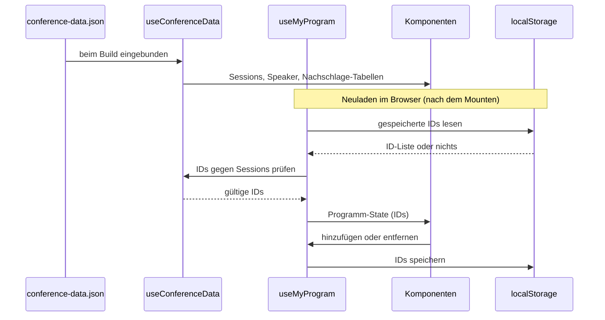

# 03 – State-Management-Konzept

Team: Cornetto Heidelbeere

## Überblick

Die App hat zwei Arten von Daten. Die Konferenzdaten aus conference-data.json sind fest und schreibgeschützt. Das Programm der Besucher ("Mein Programm") ist persönlich, veränderbar und muss einen Neustart des Browsers überstehen. Beides bekommt ein eigenes Composable, damit Komponenten keine Logik enthalten (siehe ADR 02).

## Konferenzdaten: useConferenceData()

Die JSON-Datei wird beim Build eingebunden. Das ist die einfachste Lösung, sie braucht weder Ladezustand noch Fehlerbehandlung, und die Daten sind sofort da. Die Alternative wäre ein fetch zur Laufzeit. Das würde Änderungen ohne neuen Build erlauben, bringt aber Ladezustände mit und macht die Offline-Strategie in Schritt 3 komplizierter. Weil alles in useConferenceData() gekapselt ist, können wir später auf fetch umstellen, ohne eine Komponente anzufassen. Das Composable liefert außerdem fertige Nachschlage-Tabellen für Sessions und Speaker nach ID, die einmal berechnet werden.

## Datenstruktur von "Mein Programm"

Wir speichern nur Session-IDs, zum Beispiel ["s02", "s09"]. Die Konferenzdaten bleiben so die einzige Quelle der Wahrheit. Volle Session-Objekte hätten wir doppelt, und sie könnten veralten, falls sich der Zeitplan ändert. Außerdem bleibt der gespeicherte Wert klein. Der Preis ist ein Nachschlagen pro Eintrag. Dafür dienen die Tabellen aus useConferenceData(). IDs, die es nicht mehr gibt, werden beim Laden aussortiert.

## Verteilung an die Komponenten: useMyProgram()

useMyProgram() hält die ID-Liste in einem geteilten Nuxt-State (useState) und bietet Funktionen zum Hinzufügen, Entfernen und Prüfen. SessionCard, Detailseite und Dashboard greifen alle auf denselben State zu und bleiben dadurch automatisch synchron. Wir haben drei Optionen abgewogen. Props und Events durchzureichen wird bei drei Stellen schnell unübersichtlich. Pinia bringt mehr Struktur, aber eine zusätzliche Abhängigkeit für einen sehr kleinen Zustand. Ein einfaches Composable mit useState reicht für unseren Umfang. Es ist außerdem für Nuxt gedacht, weil es auf Server und Client konsistent bleibt. Ein Zustand außerhalb einer Funktion würde beim serverseitigen Rendern zwischen Anfragen geteilt.

## Persistenz und Rehydration

Die ID-Liste liegt in localStorage unter einem versionierten Schlüssel (cornetto-my-program-v1). Für eine kleine Liste ist das einfacher als IndexedDB, das wir bei Bedarf in Schritt 3 neu bewerten. Der Ablauf beim Neuladen: Der Server rendert zuerst mit leerem Programm. Nach dem Mounten im Browser liest useMyProgram() den gespeicherten Wert, fängt ungültiges JSON ab, filtert unbekannte IDs heraus und füllt den State. Bei jeder Änderung wird zurückgeschrieben. So gibt es keine Hydration-Fehler, und defekte Daten lassen die App nicht abstürzen.

## Datenfluss

