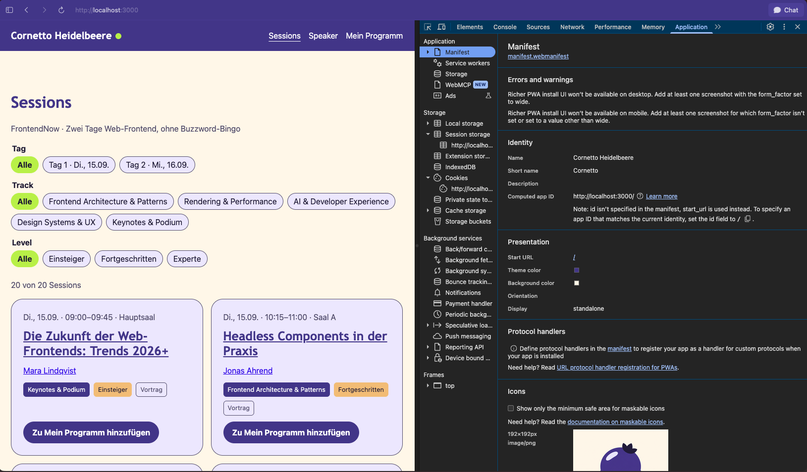
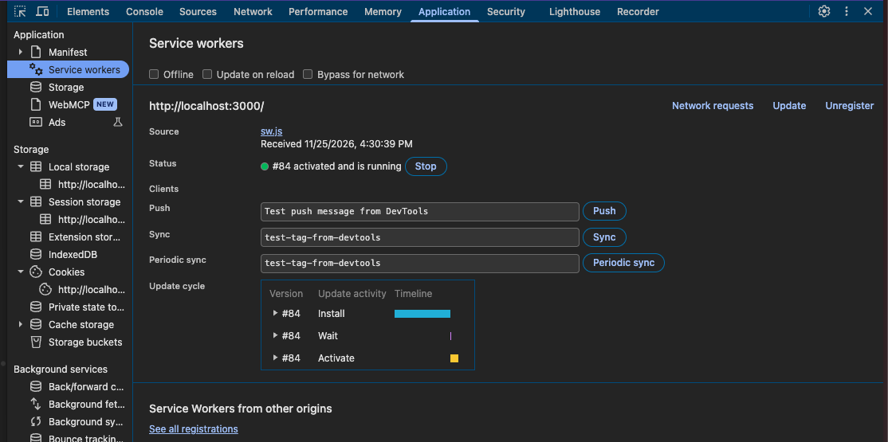
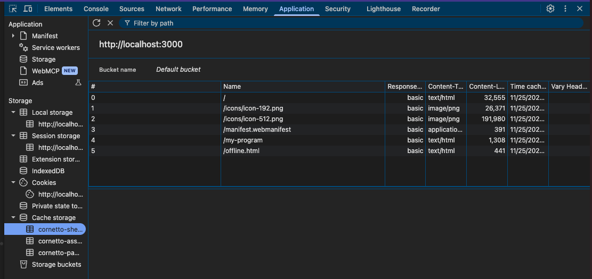
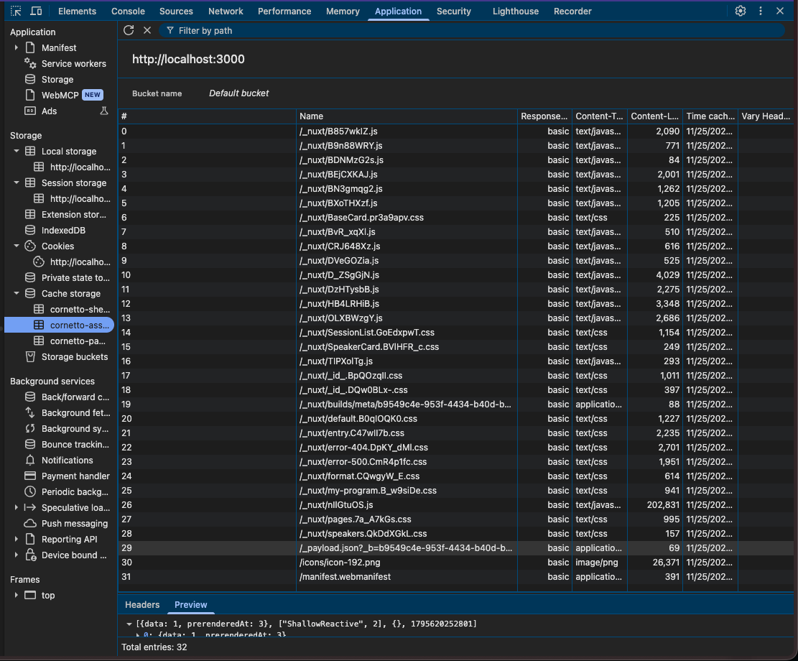
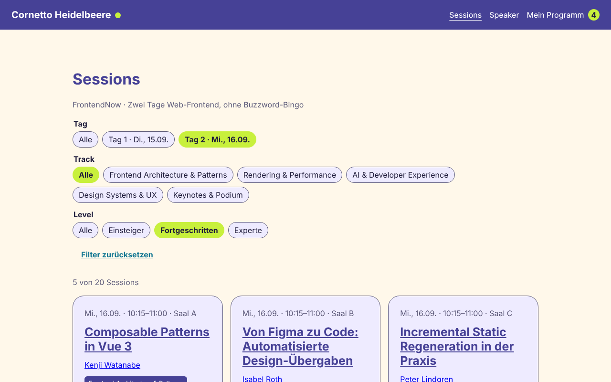
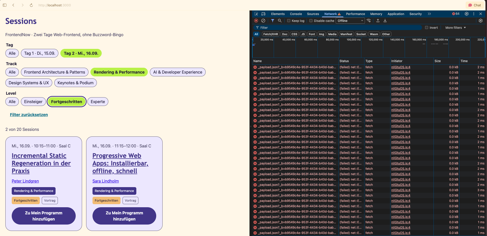
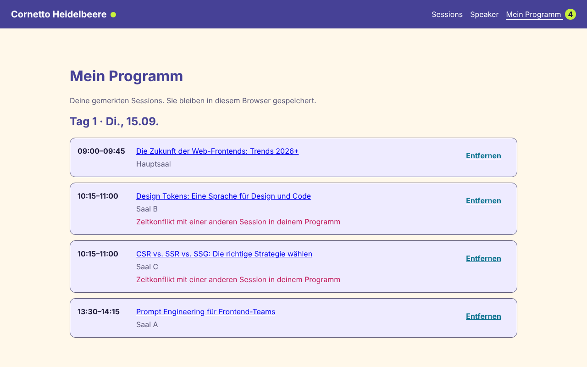
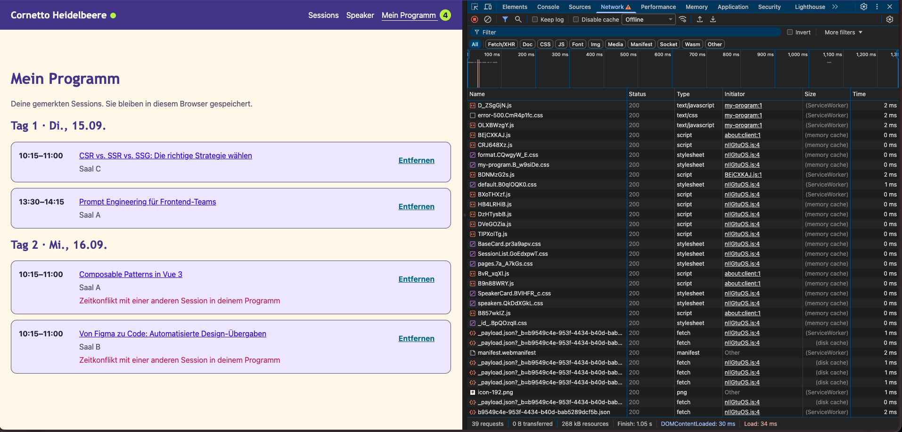
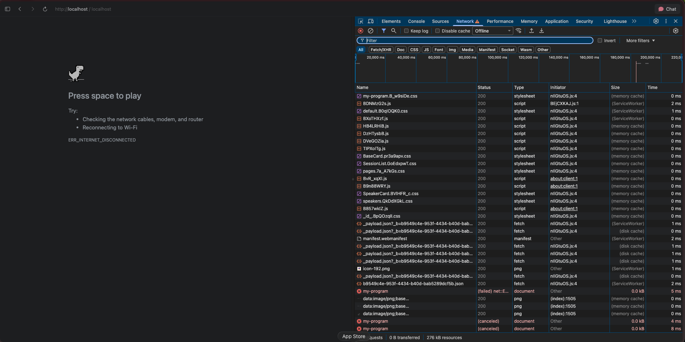
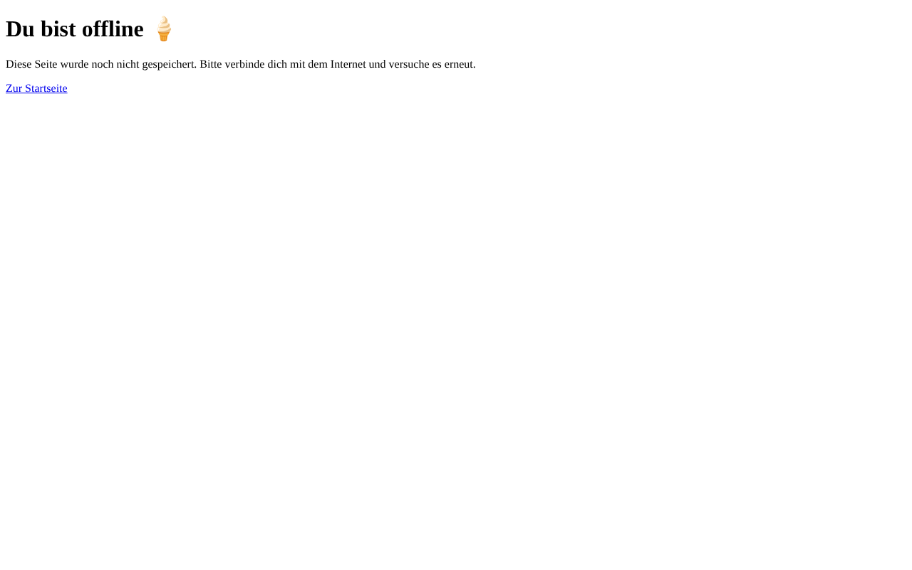

# 04 – Verifikations-Nachweis

Team: Cornetto Heidelbeere (Leo Bürger, Simon Horn, Noah Wagner)

## Testumgebung

- Produktions-Build mit `npm run build`, gestartet mit `npm run preview` auf http://localhost:3000
- Manuelle Tests in Chrome (DevTools) und Firefox auf den Rechnern von Leo, Simon und Noah
- Zusätzlich ein automatisierter Durchlauf mit Playwright und Chromium am 25.11.2026. Die Offline-Situation wurde dabei über die Offline-Emulation des Browsers hergestellt, Screenshots unten.

## Installierbarkeit und Service Worker

| Prüfung | Ergebnis | Beleg |
|---|---|---|
| Manifest wird erkannt, Installierbarkeit ohne Fehler | erfüllt |  |
| Service Worker aktiv und steuert die Seite | erfüllt |  |
| Drei Caches angelegt | erfüllt |   |

Der automatisierte Durchlauf bestätigt das. Chrome meldete über die DevTools-Schnittstelle (`Page.getInstallabilityErrors`) keine Installierbarkeitsfehler. Der Worker hatte den Status `activated`, und die Seite wurde von ihm gesteuert. Im Cache lagen danach:

```
cornetto-shell-v4:  /, /my-program, /offline.html, /manifest.webmanifest,
                    /icons/icon-192.png, /icons/icon-512.png
cornetto-assets-v4: 29 Dateien unter /_nuxt/ und /_payload.json
cornetto-pages-v4:  besuchte Navigationsseiten (z. B. /sessions/s02)
```

## Belege zu den Szenarien aus 03

Szenario 1: Übersicht offline mit kombinierten Filtern. Automatisierter Test: „Tag 2“ und „Fortgeschritten“, 5 von 20 Sessions. Noahs Test in Chrome: zusätzlich „Rendering & Performance“, 2 von 20 Sessions.




Szenario 2: „Mein Programm“ offline direkt aufgerufen, vier gespeicherte Sessions, Zeitkonflikt erkannt.




Szenario 3: Erstbesuch offline, Fehlerseite des Browsers.



Grenzfall: nie besuchte Detailseite direkt aufgerufen, eigene Offline-Seite.



## Lighthouse

Die Aufgabe nennt ein Lighthouse-PWA-Audit. Diese Kategorie gibt es seit Lighthouse 12 nicht mehr, die aktuelle Version bietet nur Performance, Accessibility, Best Practices und SEO. Die Prüfpunkte des alten Audits (Manifest, Installierbarkeit, Service Worker) haben wir deshalb im DevTools-Tab „Application“ nachgewiesen.

## Einordnung

Getestet wurden die drei Szenarien aus dem Protokoll, manuell in Chrome und Firefox und zusätzlich automatisiert in Chromium. Offline haben wir jeweils über den Browser hergestellt, nicht über das Abschalten des WLANs. Die Ergebnisse zeigen, dass Startseite und „Mein Programm“ nach einem ersten Online-Besuch ohne Netz funktionieren, einschließlich Filter und gespeicherter Auswahl. Damit sind die Kernfälle aus dem Konferenzalltag abgedeckt. In Szenario 1 verhielten sich Firefox und Chrome gleich. Die Installierbarkeit haben wir nur auf localhost geprüft, für eine echte Veröffentlichung ist HTTPS nötig.

Es gibt vier Lücken. Erstens werden Dateien erst gecacht, nachdem der Worker aktiv ist. Wer die App nur ein einziges Mal kurz öffnet, hat womöglich nicht alle Dateien gespeichert. Zweitens zeigt eine nie besuchte Detailseite beim direkten Aufruf nur die Offline-Seite, über Links in der App ist sie trotzdem erreichbar. Drittens hält Cache First gespeicherte Seiten unbegrenzt fest. Viertens schlagen offline die Vorab-Anfragen nach `_payload.json` der Speaker-Seiten fehl, weil nur die Payload der Startseite gecacht wird. Sichtbare Folgen hatte das im Test nicht. Für eine echte Konferenz mit Raumänderungen müssten wir die Detailseiten auf Stale-While-Revalidate umstellen.
